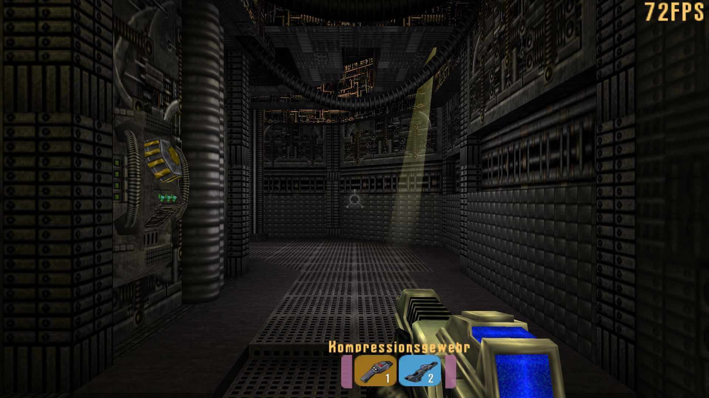
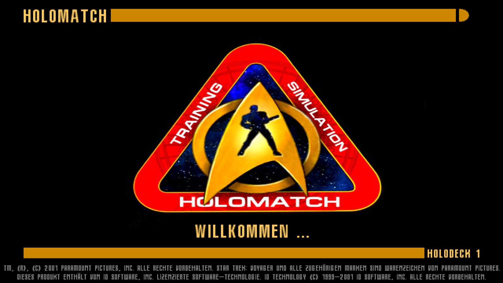

# OpenHazard

[](https://github.com/GamingTux/OpenHazard/actions/workflows/build.yml)
[](https://gamingtux.github.io/OpenHazard/)
[](LICENSE)

**OpenHazard** is a modern, portable, native **64-bit Vulkan** port of *Star Trek: Voyager – Elite Force* — unifying **Singleplayer**, **Holomatch Multiplayer**, and **Dedicated Server** on a single shared engine and Vulkan renderer for **Linux, macOS, and Windows (`x86_64` & `ARM64`)**, with first-class support for ARM64 SBCs (**Raspberry Pi 4 / 5**, RK3588, Apple Silicon).

> **No game data included:** You must provide your own legally owned retail files (`pak0.pk3`–`pak3.pk3` and `efgamex86.dll`) from an original CD or GOG installation.

---

## Screenshots (Raspberry Pi 5 — 1920×1080 Native Vulkan)

| Singleplayer (`borg2` — 4× MSAA, Half-Res Bloom, Per-Pixel Dlights) | Holomatch Multiplayer (Native 16:9 UI + Retail QVM Compatibility) |
| :---: | :---: |
|  |  |

---

## Why OpenHazard?

| Port / Method | Singleplayer | Holomatch MP | Native Vulkan | Native ARM64 / Pi 5 (16 KB pages) | Built-in Bink (`.bik`) |
|---|:---:|:---:|:---:|:---:|:---:|
| **`ioef-cmod`** | No | Yes | No (OpenGL) | Limited | No |
| **`lilium-voyager`** | No | Yes | No (OpenGL) | Untested | No |
| **GOG + Wine / Proton** | Yes (32-bit x86) | Yes | Wrapper | No (x86 emulation only) | Yes |
| **OpenHazard** | **Yes (64-bit native)** | **Yes (Retail QVMs)** | **Yes (Quake3e `renderervk`)** | **Yes (4 / 16 / 64 KB pages)** | **Yes (static FFmpeg)** |

---

## Key Features

- **Unified 64-Bit Engine & Vulkan Renderer (`engine/`):** Built on `lilium-voyager` + `Quake3e` `renderervk` (`renderer_vulkan.{so,dylib,dll}`) shared across `openhazard-sp`, `openhazard-mp`, and `openhazard-ded`.
- **Singleplayer + Skippable Cutscenes & Built-in Bink:** Native 64-bit `efgame` / `efui` modules (`efspconfig.cfg`) with a statically linked, LGPLv2.1+ **Bink-only FFmpeg 7.1.1** decoder, instant cutscene & FMV skipping (`Space`/`Enter`/`ESC`/Gamepad), and true **Hor+ Widescreen FOV** (`cg_fovAspectAdjust 1`).
- **100% Retail Multiplayer Compatibility:** `openhazard-mp` (`hmconfig.cfg`) and `openhazard-ded` (`hmconfig_server.cfg`) execute unmodified retail QVMs (`ui.qvm`, `cgame.qvm`, `qagame.qvm`) via native **ARM64 (`vm_aarch64.c`)** and **x86_64 (`vm_x86.c`)** JIT compilers, with active community master servers (`master.stvef.org`, `master.stef1.daggolin.de`, `efmaster.tjps.eu`) and dynamic `libcurl` HTTP fast map downloads.
- **Modern Vulkan Visuals & TBDR Optimizations:**
  - **Direct-to-Swapchain 4× MSAA** (transient on-chip resolve even with `r_fbo 0`), **Alpha-to-Coverage** (`r_ext_alpha_to_coverage 1`), **Per-Pixel Dynamic Lights** (`r_dlightMode 2`, `r_dlightScale 0.9`), **Quarter/Half-Resolution Bloom Pyramid** (`r_bloom 1`, `r_bloom_downscale`), **Hardware Sampler LOD Bias** (`r_mipLodBias -0.35`), **Trilinear + Anisotropic Filtering**, **Flares**, and **Triangle-Mesh Decals**.
  - **Native Hardware-ASTC Texture Packs (KTX1):** Automatic `textureCompressionASTC_LDR` loading (`r_ext_compressed_textures 1`) for `.ktx` ASTC `4×4`/`5×5`/`6×6`/`8×8` packs with precomputed mipmaps on ARM64 / Raspberry Pi 4–5 / Apple Silicon (~70 % VRAM savings) and seamless fallback to `.tga`/`.jpg` on non-ASTC desktop GPUs.
  - **TBDR / SBC Performance:** Zero-load `VK_IMAGE_LAYOUT_UNDEFINED` render passes, zero-shader `vkCmdCopyImage` swapchain fastpath, O(1) pipeline lookup hash table, pure-depth mode (stencil off unless `cg_shadows 2`), low-latency `MAILBOX` presentation (`r_swapInterval 2`), and automatic **GPU Auto-Tune** (`r_gpuAutoTune 1`) for Raspberry Pi 4 (`V3D 4.x`), Raspberry Pi 5 (`V3D 7.x`), CPU rasterizers, and Desktop GPUs.
- **Audio & Widescreen Polish:** Native **OpenAL 3D spatial audio** (`s_useOpenAL 1`, automatic SDL fallback) with **OpenAL Soft HRTF** (`s_alHrtf`), accurate SP dialog/subtitle timing and Bink A/V pacing, plus full **16:9 widescreen menus** and Hor+ framing in Singleplayer and Holomatch Multiplayer.
- **Universal ARM64 & Cross-Platform Portability:** Dynamic page-size JIT (`sysconf(_SC_PAGESIZE)` + Apple Silicon `MAP_JIT` / `pthread_jit_write_protect_np` + Windows ARM64 `VirtualAlloc` / `FlushInstructionCache`), `64 KB` ELF alignment (`-Wl,-z,max-page-size=65536`), and automatic `VK_KHR_portability_subset` for macOS MoltenVK.

---

## Portable Downloads (GitHub Actions)

Every push and release tag builds **6 self-contained, single-folder portable archives** via [`.github/workflows/build.yml`](.github/workflows/build.yml) — no installer or `.deb` required:

| Platform | Architecture | Portable Archive |
|---|---|---|
| Linux | `x86_64` | `OpenHazard-1.0.2-linux-x86_64.tar.gz` |
| Linux (Raspberry Pi 4/5, SBCs) | `arm64` | `OpenHazard-1.0.2-linux-arm64.tar.gz` |
| macOS (Apple Silicon) | `arm64` | `OpenHazard-1.0.2-macos-arm64.tar.gz` |
| macOS (Intel) | `x86_64` | `OpenHazard-1.0.2-macos-x86_64.tar.gz` |
| Windows | `x86_64` | `OpenHazard-1.0.2-windows-x86_64.zip` |
| Windows | `arm64` | `OpenHazard-1.0.2-windows-arm64.zip` |

### Game Data Directory

Place your retail `pak0.pk3`–`pak3.pk3` and `efgamex86.dll` inside `baseEF/` (or run `./openhazard-import-data.sh /path/to/setup_star_trek_voyagertm_elite_force_1.2.exe`):

- **Linux:** `~/.local/share/openhazard/baseEF/` (or `--data-dir <path>` / `OPENHAZARD_DATA_ROOT`)
- **macOS:** `~/Library/Application Support/OpenHazard/baseEF/`
- **Windows:** `%APPDATA%\OpenHazard\baseEF\` or portable `baseEF\` right next to `openhazard-sp.exe`

---

## Building from Source (Linux / macOS)

### Prerequisites (Debian / Ubuntu / Raspberry Pi OS)

```bash
sudo apt install build-essential cmake ninja-build pkg-config \
  libsdl2-dev libopenal-dev libcurl4-openssl-dev libvulkan-dev \
  innoextract # optional, for importing GOG .exe installers
```

### Build & Package

```bash
# 1. Build minimal LGPLv2.1+ Bink-only FFmpeg static libraries
./cmake/build-bink-ffmpeg.sh

# 2. Configure and build (Release + LTO, portable ARMv8.0-A / x86-64 baseline)
cmake -S . -B build -G Ninja -DCMAKE_BUILD_TYPE=Release
cmake --build build -j"$(nproc)"

# 3. Create portable archive (.tar.gz)
cpack --config build/CPackConfig.cmake -B build

# 4. Import retail data (GOG installer .exe or existing BaseEF folder)
./packaging/openhazard-import-data.sh /path/to/setup_star_trek_voyagertm_elite_force_1.2.exe

# 5. Launch (supports --fullscreen, --windowed, --wayland, --x11)
./packaging/openhazard.sh       # Singleplayer (Vulkan)
./packaging/openhazard-mp.sh    # Holomatch Multiplayer (Vulkan)
./packaging/openhazard-ded.sh   # Dedicated Server
```

### Useful Console Variables (CVARs)

| CVAR | Default | Description |
|---|---:|---|
| `r_gpuAutoTune` | `1` | Auto-tune MSAA/AF/bloom caps for Pi 4 (`V3D 4.x`), Pi 5 (`V3D 7.x`), and CPU rasterizers (`0` = manual override) |
| `r_swapInterval` | `2` | Vulkan present mode: `0` = Immediate, `1` = VSync FIFO, `2` = Low-latency Mailbox (with VSync fallback) |
| `r_ext_multisample` | `4` | Hardware MSAA sample count (`0`, `2`, `4`, `8`) |
| `r_bloom` | `1` | Half-resolution bloom post-processing (`0` / `1`) |
| `r_dlightMode` | `2` | Per-pixel dynamic lights on world + MD3 models (`0`–`2`) |
| `r_stencilbits` | `0` | Stencil buffer bits (`0` = auto/off unless `cg_shadows 2`, `8` = always on) |
| `s_useOpenAL` | `1` | OpenAL 3D spatial audio (`0` = SDL mixer fallback) |

---

## Licenses & Credits

- **Engine & Vulkan Renderer (`engine/`):** **GPLv2** ([LICENSE](LICENSE)) — based on id Tech 3, `ioquake3`, `lilium-voyager`, `Quake3e`, and `VoyagerSP`.
- **Embedded Bink Decoder (`cmake/build-bink-ffmpeg.sh`):** **LGPLv2.1+** (FFmpeg 7.1.1, minimal Bink-only build).
- **Singleplayer Game Modules (`game-sp/`):** **Raven Software STEF Game Source License** (`game-sp/STEF Game Source License.doc`).

See [CREDITS.md](CREDITS.md) for full attribution.
